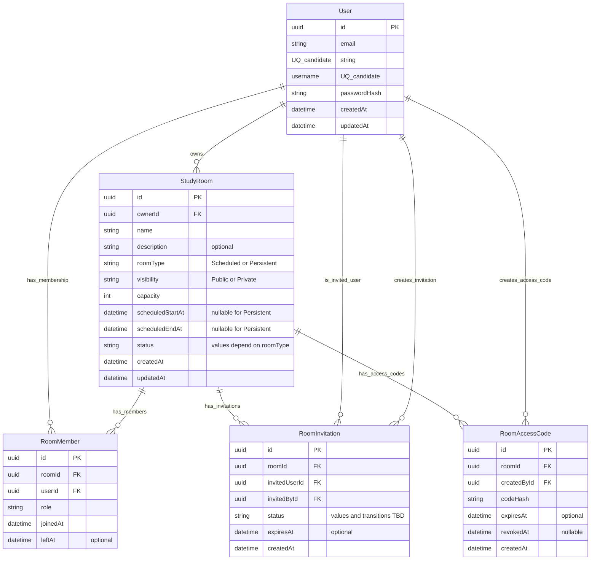

# Database Design

## 1. Status and scope

**Status: Draft — pending product decisions.** This document records a conceptual starting point for the initial relational domain. It explains proposed entities and integrity rules; it is not a finalized implementation specification.

The current Prisma schema at `apps/api/prisma/schema.prisma` defines the Prisma client generator and a PostgreSQL datasource, but it contains **no application models**. The design below is therefore conceptual and is not a description of implemented Prisma models. No migration is claimed to have been run. The Prisma 7 configuration points at the schema and migrations directory and obtains the connection URL from `DATABASE_URL`; this document does not inspect or reproduce environment values.

The scope here is the first version of users, study rooms, room membership, and the Scheduled Room Lobby design. Product behavior described as confirmed below is distinct from implementation details that remain pending. This document does not claim that Prisma models, Redis keys, migrations, background jobs, a scheduler, or Lobby code have been implemented.

## 2. Confirmed requirements

- A room is either **Scheduled** or **Persistent**.
- A room is **Public** or **Private**, according to its owner's setting.
- Local Docker development uses **PostgreSQL 17** (the `postgres:17` image in `docker-compose.yml`).
- The backend uses **NestJS** and **Prisma 7**.

These facts describe the current project direction and local setup. They do not imply that the conceptual entities below have already been implemented.

## 3. Why PostgreSQL instead of MongoDB

The initial domain has direct relationships: a user owns rooms, and users join rooms. PostgreSQL represents these relationships with foreign keys, so a room cannot point at a nonexistent owner and a membership cannot point at a nonexistent user or room. Unique constraints can protect identity fields such as email and username. A partial unique index can enforce at most one active membership for a user-room pair while retaining older membership periods.

Transactions are useful for operations that must change related records together, such as creating a room and its initial owner membership or admitting a participant while respecting room capacity. Relational constraints and transactions provide a strong foundation for keeping these records consistent as the API evolves.

MongoDB could represent this domain using documents and references, and it remains a viable option if access patterns and product requirements favor its document model. It is not the default here because the core records have meaningful cross-entity relationships and integrity rules; modeling them relationally makes those rules explicit and lets the database enforce many of them. This is a contextual choice for this project's initial domain, not a universal claim that SQL is always better.

Redis is selected for the live Scheduled Room Lobby waiting queue and transient connection/presence state. These are short-lived, operational data that benefits from fast queue operations and expiry. Redis is not authoritative for admission: PostgreSQL remains the source of truth for users, rooms, membership history, authorization-related domain data, and capacity enforcement. Queue order establishes priority, not a guaranteed seat, and admission must be confirmed against PostgreSQL under concurrency control.

The first version does not guarantee restoration of Lobby positions after Redis data loss or a Redis service restart; affected users may need to rejoin. A temporarily disconnected waiting user has a **30-second reconnection grace period**, a product decision for this project rather than a claim about Zoom or Google Meet internals. Reconnection within that period should attempt to retain the user's queue position. Once the period expires, remove the user; a later rejoin enters at the end of the queue.

A future hybrid architecture introduces operational complexity: PostgreSQL and Redis can disagree or fail independently, queue operations need reconnection and expiry handling, and admission must reconcile queue state with current authorization and database capacity. The implementation must define how retries, duplicate attempts, stale queue entries, and service recovery behave without treating Redis as proof that a seat is reserved. A vector-search system may be useful if AI/RAG features need semantic retrieval; that remains separate from this core-domain storage decision.

## 4. Core entities

| Entity | Conceptual responsibility | Key design notes |
| --- | --- | --- |
| `User` | Account identity and authentication identity | Store a unique email and username, a password hash (never a plaintext password), and creation/update timestamps. Authentication policy such as email normalization and username case sensitivity must inform the eventual unique indexes. |
| `StudyRoom` | A study space and its lifecycle | Belongs to one owner; stores name, optional description, room type, visibility, positive maximum capacity, schedule fields, status, and timestamps. Schedule nullability depends on room type (see integrity rules). |
| `RoomMember` | A user's relationship to a room for one membership period | Has a surrogate UUID `id`, references one user and one room, and stores `joinedAt` plus nullable `leftAt`. `leftAt IS NULL` denotes an active membership. Each rejoin creates a new record. |
| `RoomInvitation` | An invitation for a specific user to access a specific room | References the room, the invited user, and the user who created the invitation. Its exact status values and transitions, and whether repeated invitations for the same user-room pair are allowed, remain undecided. |
| `RoomAccessCode` | A reusable credential for a specific room | Stores a hash of the code, not the raw code, and references its room and creator. A code may optionally expire and may be revoked. Code generation, hashing details, rate limiting, and uniqueness/index rules remain implementation-level design work. |

`RoomMember` is an explicit entity rather than an unadorned many-to-many relation because the relationship has its own identity and behavior: role, join/leave times, capacity admission, and a history of membership periods. Each join period receives a new surrogate UUID `id`; ending a period sets `leftAt`, and a later rejoin inserts a new row. The `userId` and `roomId` foreign keys identify the related user and room without serving as the row's primary key.

## 5. Conceptual ERD

The following is a **conceptual ERD, not the final Prisma schema**. `PK` marks primary keys, `FK` marks foreign keys, and `UQ candidate` marks a proposed candidate unique field. Email/username uniqueness assumes the product settles normalization and case-sensitivity rules. `RoomMember.id` is the surrogate primary key. The active-pair uniqueness rule is a partial unique index, described below, and is not fully expressed by this conceptual ERD.



`ownerId` expresses room ownership. An OWNER `RoomMember` is also shown as a possible membership representation, but its agreement with `ownerId` is a cross-row invariant that needs an explicit write strategy (see below).

The two user references on `RoomInvitation` have distinct meanings: `invitedUserId` identifies the intended recipient, while `invitedById` identifies the user who created the invitation. `RoomAccessCode.createdById` records which user created that room's reusable credential. These are conceptual relationships; they do not prescribe notification delivery or a specific invitation workflow.

## 6. Data integrity and concurrency

- **Capacity:** `StudyRoom.capacity` (the maximum participant count) must be positive. A database `CHECK` constraint is a suitable defense in depth in addition to API validation.
- **Scheduled time range:** Scheduled rooms require non-null start and end timestamps, with end later than start. Persistent rooms have null start and end timestamps under this current proposal. API validation should give useful errors, while database constraints should protect persisted data from invalid writes. The eventual schema should encode both the type/nullability rule and the time-order rule where practical.
- **Membership history and active uniqueness:** Each membership period is a separate `RoomMember` row with its own UUID primary key. A plain unique constraint on `(roomId, userId)` would allow only one row for that pair for all time, so after a member leaves, it would prevent inserting another row on rejoin and would destroy the chosen period-by-period history model. Instead, enforce at most one active row for a pair with a PostgreSQL partial unique index on `(roomId, userId)` with predicate `leftAt IS NULL`. Historical rows with a non-null `leftAt` remain unrestricted by that index. Prisma 7 supports partial indexes behind the `partialIndexes` preview feature; this is a design note only, and the Prisma schema is not being changed here.
- **Capacity under concurrent joins:** A naïve operation that counts current members and then inserts a membership is unsafe. Two requests can both observe one remaining place, both pass the check, and both insert, exceeding capacity. Joining must enforce capacity atomically. One strategy is a transaction that locks the room row (or another stable capacity record), counts eligible active memberships, and inserts only if capacity remains; all admission paths must use the same locking protocol. Another justified strategy could use an atomic seat counter with guarded updates and carefully maintained consistency. A transaction alone is not sufficient if concurrent transactions can perform the same unprotected count-and-insert sequence.
- **Owner and OWNER membership consistency:** `StudyRoom.ownerId` and an OWNER role in `RoomMember` are two representations of ownership if both are stored. A normal foreign key can ensure that each reference points to an existing user/room, but it cannot by itself ensure that the room's `ownerId` equals the user in its OWNER membership, nor that exactly one such membership exists. Decide whether ownership is represented in one place or both. If both are retained, enforce consistency through a transactionally controlled creation/transfer path and consider database-level mechanisms or validation for defense in depth; document the invariant and test it.
- **Delete behavior:** Referential actions (restrict, cascade, or soft deletion) are not settled here. They must be selected deliberately because deleting a user or room can affect membership history and auditability.

## 7. Authorization and privacy

Public/Private is a visibility setting, not a complete authorization model. Public means a room may be discoverable according to product rules; it does not automatically grant every operation. Private means the room should not be discoverable or joinable by an arbitrary caller. For the first version, private-room access is **Invitation OR Access Code**: either a valid invitation associated with that specific user and room, or a valid code for that room, is sufficient. A code is an independent alternative; a user with a valid code does not also need an individual invitation.

Access codes are reusable by multiple users until they expire or are revoked. An authorized owner may revoke a code; expiry is optional. A valid code still grants no guaranteed seat: every use must pass backend validation, room lifecycle checks, and capacity/admission checks. Join requests and their approval workflow are out of scope for v1. The backend validates the invitation or code when entering the Lobby and checks authorization again when actual admission is attempted. UI visibility is not security, and a Redis Lobby entry is not an authorization grant.

The backend must enforce authorization on every relevant read and write, including room discovery, room details, Lobby entry, admission attempts, invitation management, and access-code management. For a Private Room, validate the invitation or access code server-side both when the user enters the Lobby and again when admission is attempted; a previous check or Redis queue entry is not an authorization grant. Hiding a room or button in the UI is not a security control because clients can call API endpoints directly.

## 8. Confirmed room lifecycle

`roomType` and `status` describe different concepts. `roomType` identifies the room's operating model—**Persistent** or **Scheduled**—while `status` describes where that room is in its lifecycle. Status values and transitions are therefore constrained by room type; `CLOSED` and `ARCHIVED` are Persistent Room states and are not part of the Scheduled Room lifecycle in v1.

### Persistent Rooms

| Current status | Allowed next status | Meaning |
| --- | --- | --- |
| `ACTIVE` | `CLOSED` | The room is available for use; the owner may temporarily close it. |
| `CLOSED` | `ACTIVE` | The owner reopens the temporarily unavailable room. |
| `CLOSED` | `ARCHIVED` | The room is archived as a terminal v1 state. |
| `ARCHIVED` | None | No transitions out of `ARCHIVED` are allowed in v1. |

Allowed transitions, stated explicitly:

```text
ACTIVE -> CLOSED
CLOSED -> ACTIVE
CLOSED -> ARCHIVED
```

Archiving preserves the `StudyRoom` record and its `RoomMember` history. `ARCHIVED` is not a deletion operation and is not normally reopenable in v1.

### Scheduled Rooms

The Scheduled Room lifecycle remains:

```text
SCHEDULED -> ACTIVE (automatically at startsAt) -> ENDED
SCHEDULED -> CANCELLED
```

`SCHEDULED -> CANCELLED` is allowed only when the owner cancels before the session starts. `ACTIVE -> ENDED` occurs when the session ends. `CLOSED` and `ARCHIVED` are not Scheduled Room statuses in v1. A reliable backend mechanism is required to perform the automatic transition at `startsAt`; the design does not imply that a scheduler or transition job exists. Reliability and recovery hardening for this mechanism is planned for the reliability work.

### Scheduled Room Lobby and admission

A user may request to join a Scheduled Room before `startsAt`. Until the room becomes `ACTIVE`, that user waits in the live Lobby and has no `RoomMember` row. When the room automatically transitions to `ACTIVE`, the backend attempts to admit waiting users in FIFO order. FIFO order provides priority, not a guaranteed seat: if capacity is full when an attempt is made, the user remains in the Lobby and may see: `Room is full. You can keep waiting or leave the lobby.` The user may leave voluntarily without creating a membership-period record.

When a seat becomes available, the backend attempts admission for waiting users in FIFO order. Recheck current authorization and capacity at the time of each attempt. Create a `RoomMember` row only after successful admission to the active room. Lobby waiting, leaving, and failed admission do not create membership-period history. Admission and capacity enforcement must be concurrency-safe; PostgreSQL is authoritative for membership and capacity, and Redis queue state alone must never guarantee a seat. Coordinate the admission transaction/locking strategy with the capacity rule in the data-integrity section.

Redis manages the live waiting order and transient connection/presence state. If a waiting user disconnects temporarily, retain their position only if they reconnect within the product-defined 30-second grace period; after expiry remove them, and a later rejoin goes to the queue tail. The v1 design does not guarantee restoring queue positions after Redis data loss or service restart, so affected users may need to rejoin.

### Enforcement

The backend must authorize lifecycle changes according to the actor permissions and validate each state transition against the current `roomType` and `status`, including owner reopening of a Persistent Room and owner cancellation of a Scheduled Room before it starts. Reject transitions not listed above, including every transition out of `ARCHIVED`. UI controls alone do not enforce lifecycle rules; authorization and transition validation belong on the server. The eventual persistence design should also guard against invalid room-type/status combinations where practical. The `SCHEDULED -> ACTIVE` transition at `startsAt` requires a reliable backend mechanism; scheduler implementation, recovery behavior, and reliability hardening remain future work planned for the reliability work.

## 9. Out of scope for the initial schema

The initial schema described here does not model:

- Chat messages and message retention/order.
- WebRTC sessions, signaling, or other transient session data.
- Presence and ephemeral online/active state as PostgreSQL domain records (transient connection/presence state belongs in Redis under the confirmed storage decision).
- AI/RAG source documents, chunks, embeddings, or retrieval metadata.

These concerns have different lifecycle, volume, and consistency requirements. Chat, WebRTC, and AI/RAG will be designed in their respective sprints once the related product and technical requirements are clear. Redis use for the live Lobby queue and transient connection/presence state is the confirmed exception described above; detailed keys, expiration behavior, and recovery implementation are still pending and are not defined here.

## 10. Next steps

1. Resolve remaining product and implementation decisions, including invitation states/transitions, repeated invitations for one user-room pair, access-code uniqueness/indexing, deletion behavior, and how `StudyRoom.ownerId` relates to an OWNER membership.
2. Finalize entity fields, relations, deletion policy, indexes, and database constraints based on those decisions.
3. Update the Prisma schema to reflect the approved model and constraints.
4. Validate the Prisma schema and review the generated migration before applying it.
5. Create a migration, then test important invariants, including schedule validity, membership uniqueness/history behavior, authorization paths, and capacity under concurrent joins.
