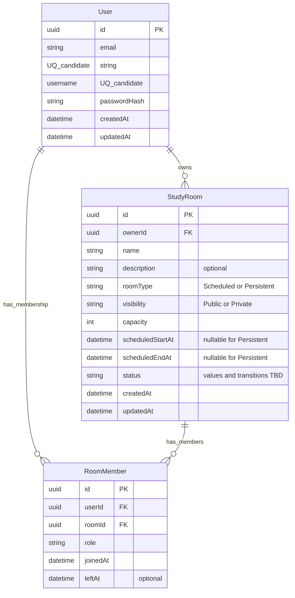

# Database Design

## 1. Status and scope

**Status: Draft — pending product decisions.** This document records a conceptual starting point for the initial relational domain. It explains proposed entities and integrity rules; it is not a finalized implementation specification.

The current Prisma schema at `apps/api/prisma/schema.prisma` defines the Prisma client generator and a PostgreSQL datasource, but it contains **no application models**. The design below is therefore conceptual and is not a description of implemented Prisma models. No migration is claimed to have been run. The Prisma 7 configuration points at the schema and migrations directory and obtains the connection URL from `DATABASE_URL`; this document does not inspect or reproduce environment values.

The scope here is the first version of users, study rooms, and room membership. Product decisions listed later must be resolved before treating these proposals as final constraints.

## 2. Confirmed requirements

- A room is either **Scheduled** or **Persistent**.
- A room is **Public** or **Private**, according to its owner's setting.
- Local Docker development uses **PostgreSQL 17** (the `postgres:17` image in `docker-compose.yml`).
- The backend uses **NestJS** and **Prisma 7**.

These facts describe the current project direction and local setup. They do not imply that the conceptual entities below have already been implemented.

## 3. Why PostgreSQL instead of MongoDB

The initial domain has direct relationships: a user owns rooms, and users join rooms. PostgreSQL represents these relationships with foreign keys, so a room cannot point at a nonexistent owner and a membership cannot point at a nonexistent user or room. Unique constraints can protect identity fields such as email and username, and (if the product chooses one-row-per-pair membership) prevent duplicate active relationship rows.

Transactions are useful for operations that must change related records together, such as creating a room and its initial owner membership or admitting a participant while respecting room capacity. Relational constraints and transactions provide a strong foundation for keeping these records consistent as the API evolves.

MongoDB could represent this domain using documents and references, and it remains a viable option if access patterns and product requirements favor its document model. It is not the default here because the core records have meaningful cross-entity relationships and integrity rules; modeling them relationally makes those rules explicit and lets the database enforce many of them. This is a contextual choice for this project's initial domain, not a universal claim that SQL is always better.

Redis may be useful later for ephemeral presence, coordination, or caching if measured requirements call for it. A vector-search system may be useful if AI/RAG features need semantic retrieval. Neither is a current dependency of the core database design; those choices should follow concrete requirements in their respective work.

## 4. Core entities

| Entity | Conceptual responsibility | Key design notes |
| --- | --- | --- |
| `User` | Account identity and authentication identity | Store a unique email and username, a password hash (never a plaintext password), and creation/update timestamps. Authentication policy such as email normalization and username case sensitivity must inform the eventual unique indexes. |
| `StudyRoom` | A study space and its lifecycle | Belongs to one owner; stores name, optional description, room type, visibility, positive maximum capacity, schedule fields, status, and timestamps. Schedule nullability depends on room type (see integrity rules). |
| `RoomMember` | A user's relationship to a room | References one user and one room; stores a role, when the member joined, and an optional time they left. The membership policy and history requirements determine the uniqueness and rejoin behavior. |

`RoomMember` should be an explicit entity rather than an unadorned many-to-many relation because the relationship itself has data and behavior: role, join/leave times, capacity admission, and potentially membership history. It also gives the API a clear place to enforce membership lifecycle rules. Whether a rejoin updates a prior row or starts a new membership period remains an open product decision.

## 5. Conceptual ERD

The following is a **conceptual ERD, not the final Prisma schema**. `PK` marks primary keys, `FK` marks foreign keys, and `UQ candidate` marks a proposed candidate unique field. Email/username uniqueness assumes the product settles normalization and case-sensitivity rules. A unique `(userId, roomId)` pair is appropriate only if the product selects one row per user-room pair; it is intentionally not imposed by this draft while membership history is undecided.

`ownerId` expresses room ownership. An OWNER `RoomMember` is also shown as a possible membership representation, but its agreement with `ownerId` is a cross-row invariant that needs an explicit write strategy (see below).

## 6. Data integrity and concurrency

- **Capacity:** `StudyRoom.capacity` (the maximum participant count) must be positive. A database `CHECK` constraint is a suitable defense in depth in addition to API validation.
- **Scheduled time range:** Scheduled rooms require non-null start and end timestamps, with end later than start. Persistent rooms have null start and end timestamps under this current proposal. API validation should give useful errors, while database constraints should protect persisted data from invalid writes. The eventual schema should encode both the type/nullability rule and the time-order rule where practical.
- **Membership uniqueness/history:** The correct unique constraint depends on the unresolved history policy. A single row per user-room pair can use a unique pair constraint; multiple membership periods need a different key strategy and constraints that permit history while preventing conflicting active periods.
- **Capacity under concurrent joins:** A naïve operation that counts current members and then inserts a membership is unsafe. Two requests can both observe one remaining place, both pass the check, and both insert, exceeding capacity. Joining must enforce capacity atomically. One strategy is a transaction that locks the room row (or another stable capacity record), counts eligible active memberships, and inserts only if capacity remains; all admission paths must use the same locking protocol. Another justified strategy could use an atomic seat counter with guarded updates and carefully maintained consistency. A transaction alone is not sufficient if concurrent transactions can perform the same unprotected count-and-insert sequence.
- **Owner and OWNER membership consistency:** `StudyRoom.ownerId` and an OWNER role in `RoomMember` are two representations of ownership if both are stored. A normal foreign key can ensure that each reference points to an existing user/room, but it cannot by itself ensure that the room's `ownerId` equals the user in its OWNER membership, nor that exactly one such membership exists. Decide whether ownership is represented in one place or both. If both are retained, enforce consistency through a transactionally controlled creation/transfer path and consider database-level mechanisms or validation for defense in depth; document the invariant and test it.
- **Delete behavior:** Referential actions (restrict, cascade, or soft deletion) are not settled here. They must be selected deliberately because deleting a user or room can affect membership history and auditability.

## 7. Authorization and privacy

Public/Private is a visibility setting, not a complete authorization model. Public means a room may be discoverable according to product rules; it does not automatically grant every operation. Private means the room should not be discoverable or joinable by an arbitrary caller, subject to the eventual invitation/request flow.

The backend must enforce authorization on every relevant read and write, including room discovery, room details, join attempts, and membership management. Private-room access checks must run server-side. Hiding a room or button in the UI is not a security control because clients can call API endpoints directly.

## 8. Open decisions — product input required

These choices affect constraints, API behavior, and how the database preserves history. This draft deliberately leaves them open.

### Membership history

- **A. One row per user-room pair, reactivated on rejoin.** The pair can be unique and a rejoin clears `leftAt` and refreshes the current membership state. This is simpler for current membership and capacity queries, but prior join/leave periods are overwritten unless separate audit data is retained.
- **B. Separate rows for each membership period.** Each join creates a new row, preserving historical periods. Current membership queries must identify the active period, and constraints/indexes must prevent more than one active membership for the same user-room pair while allowing prior inactive rows. Capacity counts only active memberships.

### Private-room entry

- **A. Owner/moderator invitations only.** The server checks that an invitation exists and is valid before admitting the invitee. This keeps entry controlled by an explicit grant, but requires invitation lifecycle and revocation rules.
- **B. Invitations or a revocable/expiring code.** This adds a shareable entry path. The product must decide code entropy, storage (prefer storing a verifier/hash rather than a reusable plaintext secret), expiration, revocation, and whether codes are single-use or reusable. Code access still requires server-side validation.
- **C. Invitations/code plus owner/moderator approval of join requests.** This adds a review workflow and pending request state, including decisions about duplicates, expiration, cancellation, and who may approve. It offers an additional control point but adds state transitions and operational complexity.

### Room status and lifecycle

The status values and allowed transitions remain undecided. Define which states exist (for example, whether a room can be draft, open, ended, or cancelled) and which transitions are allowed before encoding enums, constraints, or API rules. Status affects whether users can discover or join a room and how scheduled rooms behave before and after their time window. Avoid deriving lifecycle behavior from a status label until its meaning and transition rules are agreed.

## 9. Out of scope for the initial schema

The initial schema described here does not model:

- Chat messages and message retention/order.
- WebRTC sessions, signaling, or other transient session data.
- Presence and ephemeral online/active state.
- AI/RAG source documents, chunks, embeddings, or retrieval metadata.

These concerns have different lifecycle, volume, and consistency requirements. They will be designed in their respective sprints once the related product and technical requirements are clear; this document does not prescribe their storage systems.

## 10. Next steps

1. Resolve the membership-history, private-room-entry, and room-lifecycle decisions with product stakeholders.
2. Finalize entity fields, relations, deletion policy, indexes, and database constraints based on those decisions.
3. Update the Prisma schema to reflect the approved model and constraints.
4. Validate the Prisma schema and review the generated migration before applying it.
5. Create a migration, then test important invariants, including schedule validity, membership uniqueness/history behavior, authorization paths, and capacity under concurrent joins.
